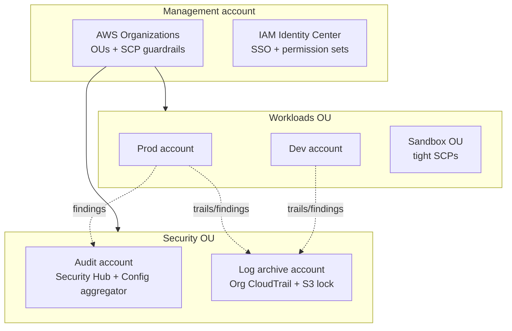

# Secure Public-Sector Landing Zone

Reusable OpenTofu modules for the AWS multi-account baseline every government and regulated team rebuilds from scratch: organization structure with guardrails, a CIS-aligned security baseline, centralized logging, and identity. Deployable in under an hour.

Born from building public-sector cloud infrastructure at GovTech Barbados and managing a 14-account, SOC 2-audited AWS organization. The goal is a baseline that is boring, auditable, and reproducible.

**Stack:** OpenTofu · AWS Organizations · SCPs · CloudTrail · AWS Config · Security Hub · IAM Identity Center

## Architecture



## Modules

| Module | Status | What it provisions |
| --- | --- | --- |
| `modules/organization` | ✅ Phase 1 | OUs (Security, Workloads, Sandbox), SCP guardrails attached per-OU |
| `modules/security-baseline` | 🚧 Phase 2 | Org CloudTrail to a locked S3 bucket, AWS Config recorder + CIS conformance pack, Security Hub with central aggregation |
| `modules/identity` | 📋 Phase 3 | IAM Identity Center permission sets (admin, poweruser, readonly, billing) |
| `modules/logging` | 📋 Phase 3 | Centralized log-archive bucket policies, retention, Object Lock |

## Guardrails included (Phase 1)

SCPs in `policies/`, applied through the organization module:

- `deny-root-user.json` — block root-account actions everywhere except break-glass
- `deny-unapproved-regions.json` — restrict activity to an approved region list
- `require-imdsv2.json` — deny EC2 launches without IMDSv2
- `protect-security-services.json` — deny disabling CloudTrail, Config, GuardDuty, Security Hub

## Usage

```hcl
module "organization" {
  source = "./modules/organization"

  approved_regions = ["us-east-1", "ca-central-1"]
  sandbox_max_regions = ["us-east-1"]
}
```

See `examples/full-org` for a complete management-account configuration.

```bash
cd examples/full-org
tofu init
tofu plan
```

## Phases

1. **Organization + guardrails** (this release): OUs and SCPs as code, importable into an existing org.
2. **Security baseline**: org trail, Config + CIS pack, Security Hub aggregation into the audit account.
3. **Identity + logging**: Identity Center permission sets, hardened log-archive account.
4. **Walkthrough**: "zero to governed org in 30 minutes" guide with screenshots.

## License

MIT — built by [Christopher Corbin](https://christophercorbin.cloud)
